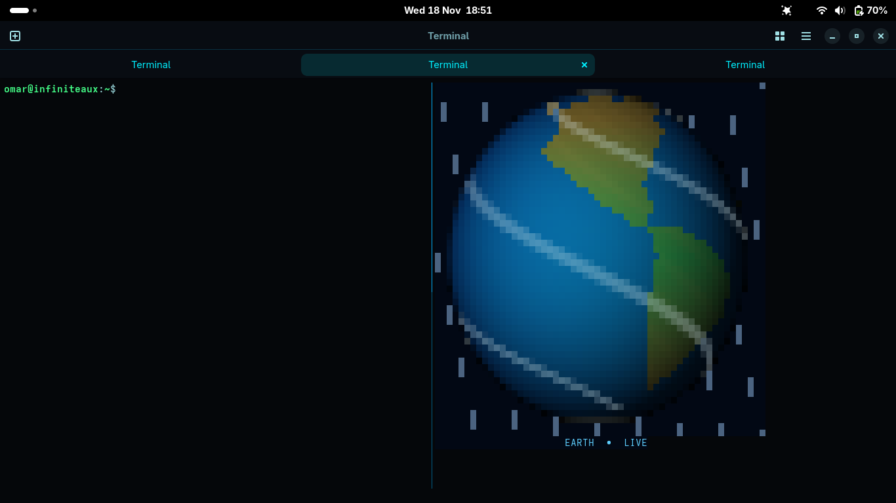

# Earth Terminal

A live, rotating Earth rendered in 24-bit color inside a dedicated tmux pane while you
keep using your normal shell right next to it.



[](LICENSE)
[](https://www.python.org/)
[](https://github.com/tmux/tmux)
[]()
[](https://github.com/OmarLarrondo/earth-terminal/stargazers)

No Python dependencies beyond the standard library. All you need is `bash` and `tmux`.

## Features

- A rotating globe animated at 10 FPS using half-block characters (`▀`) and 24-bit RGB
  color.
- Continents drawn from longitude/latitude polygons, with a soft terminator, polar ice,
  cloud bands and a starfield background.
- The animation lives in its own tmux pane, so it **never redraws over or interferes
  with the command line** you are typing.
- Adapts to your window size and degrades gracefully: on a small terminal, or without
  `tmux`, it falls back to a plain shell instead of breaking.
- Cleans up its tmux session on exit and restores the terminal state properly.

## Quick start

```bash
git clone https://github.com/OmarLarrondo/earth-terminal.git
cd earth-terminal
./install.sh
```

Then open a new terminal (or run `exec bash`).

The installer copies both scripts to `~/bin` and appends the auto-start block to your
`~/.bashrc` only if it is not there already. Make sure `~/bin` is on your `PATH`.

### Manual installation

```bash
mkdir -p ~/bin
cp earth-terminal spinning-earth ~/bin/
chmod +x ~/bin/earth-terminal ~/bin/spinning-earth
```

Add this to the end of your `~/.bashrc`:

```bash
# Start the rotating Earth in a dedicated tmux pane for interactive terminals.
# Set NO_EARTH_TERMINAL=1 before launching Bash to opt out temporarily.
if [[ $- == *i* ]] \
    && [ -t 0 ] && [ -t 1 ] \
    && [ -z "${TMUX:-}" ] \
    && [ -z "${NO_EARTH_TERMINAL:-}" ] \
    && [ "${TERM:-}" != "dumb" ] \
    && command -v earth-terminal >/dev/null 2>&1; then
    exec earth-terminal
fi
```

## Usage

Open a new terminal and the globe appears on the right.

| Variable | Default | Description |
| --- | --- | --- |
| `EARTH_PANE_WIDTH` | `42` | Width in columns of the globe pane. |
| `NO_EARTH_TERMINAL` | _(empty)_ | Set to `1` to start without the globe. |

```bash
# A narrower globe
EARTH_PANE_WIDTH=34 exec bash

# Start without the globe this time
NO_EARTH_TERMINAL=1 exec bash
```

To watch the animation on its own, full screen:

```bash
./spinning-earth
```

## How it works

- `earth-terminal` is a Bash wrapper. It checks the terminal size, starts a detached
  tmux session, puts your shell on the left and `spinning-earth` on the right. A `trap`
  and a tmux hook tear the session down when you exit.
- `spinning-earth` is a Python renderer. It projects a sphere, tests each point against
  the continent polygons, applies lighting and writes each frame with ANSI escape
  sequences.

## Windows

The wrapper depends on `tmux`, which has no native Windows build. Use one of these:

- **WSL2** (recommended): works exactly like on Linux, and Windows Terminal renders the
  24-bit colors correctly.
- **Globe only:** `spinning-earth` is plain Python, so `python spinning-earth` runs
  natively in Windows Terminal (no split pane or side-by-side shell).
- **MSYS2** ships tmux, but it is more work than simply using WSL.

## Uninstall

```bash
rm ~/bin/earth-terminal ~/bin/spinning-earth
```

Then remove the block starting with `# Start the rotating Earth` from your `~/.bashrc`.

## License

MIT. See [LICENSE](LICENSE).
